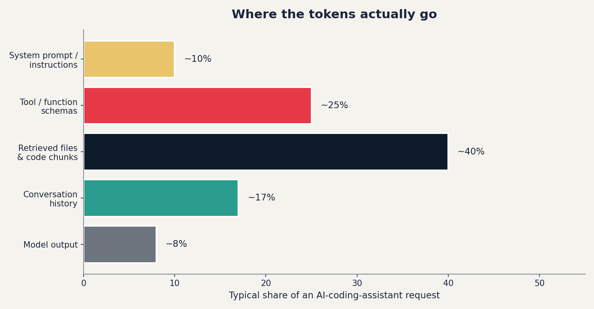

<!-- target: ~200 words -->

# Context Is a Budget — Reducing Token Usage in AI-Assisted Development

*Eight levers and three workflow patterns that pay for themselves in a week.*

A team of fifty developers can quietly burn $30,000 a month on AI coding assistants without anyone noticing. Premium-request quotas vanish by the third week. The bill arrives. Nobody has a story for where it went.

The cost is the obvious pain. The other two are sneakier:

- **Latency.** Bigger contexts take longer. The model thinks more, but you also wait more.
- **Context rot.** This is the surprising one. Anthropic and Chroma have both shown that as the context window fills up, model recall and reasoning *degrade* — even well inside the advertised window. The 200K-token model is genuinely worse at the 150K mark than at the 20K mark. **More context is not free; past a point, it's actively harmful.**

The mental model that fixes all three: stop treating context as a free buffet. Treat it as a budget you spend on every turn.

This post is a practical guide to spending it well: where the tokens actually go, eight levers that move the needle, and three workflow patterns that compound on top of them.

