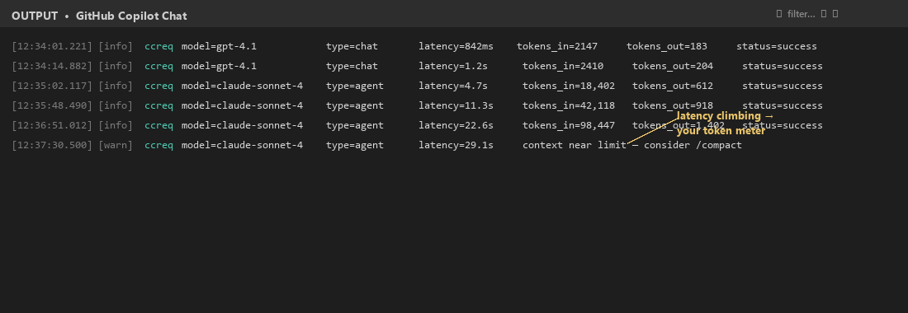

<!-- target: ~300 words -->

## Where the tokens actually go

Every request to a coding assistant is a stack of buckets. The shape varies by tool and session, but it tends to look like this:

| Bucket | Typical share | Notes |
|---|---|---|
| System prompt / instructions | 5–15% | Boilerplate that's been copy-pasted for months |
| Tool / function schemas | 10–40% | Re-sent on **every** turn |
| Retrieved files & code chunks | 20–60% | The biggest lever, almost always |
| Conversation history | 10–30% | Grows linearly until you compact it |
| Model output | 5–20% | Verbose prose is expensive to produce *and* to read |

A few things to notice:

- **Tool schemas dominate more than people expect.** Five connected MCP servers can easily contribute 5,000–10,000 tokens to every request before you've typed a word. The model doesn't have to *use* the tool — the schema ships either way.
- **Conversation history grows without bound.** A 30-turn chat is paying for the first 29 turns on every new question, plus your fresh one.
- **Output is small in volume but expensive per token.** On most direct APIs, output tokens cost three to five times input tokens. A reply that says "Sure! Let me explain what I'm about to do…" before doing it is pure tax.

> **Rule of thumb:** profile your own traffic before optimizing. The bucket dominating *your* sessions is rarely the one your gut says.

In a Copilot context, you can't see token counts directly — but you can see the symptom. Open **Output → "GitHub Copilot Chat"** and watch the `ccreq` lines: each one shows the model, latency, and request type per turn. When the same question takes three times longer in chat #2 than chat #1, you've just watched your token meter the entire time.

