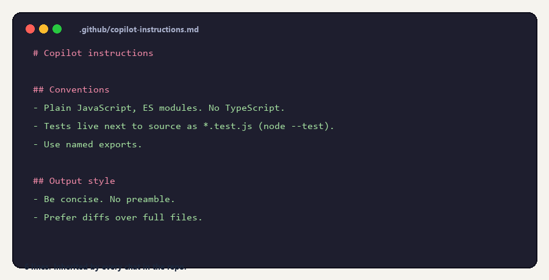
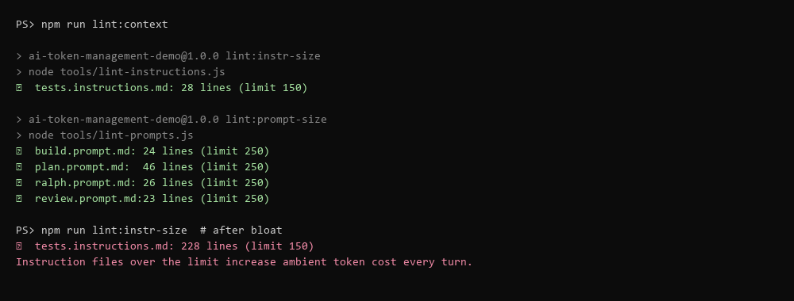

<!-- target: ~1,800 words (~225 per lever × 8) -->

## The eight levers

These aren't in priority order — they're in the order you'd naturally encounter them in a session. The first three (context, caching, tools) are about the request *shape*. The next three (instructions, model, output) are about how you *talk* to the assistant. The last two (repo, observability) are the foundations that make all of the others stick.

---

### A. Context engineering — scope your asks

The single biggest waste in most AI workflows is asking vague questions of agent-mode chat with full codebase access. The agent dutifully explores, reads ten files to find the two it needed, summarizes them all, and then answers. You pay for every step.

Compare:

> **Bad:** *"Refactor the order confirmation email to use the new template engine."*
> The agent opens four files in `src/email/`, reads `welcomeEmail.js` for context it doesn't need, considers whether `templates/` should exist, and proposes a sprawling diff that renames a function on the way through.

> **Good:** *"Refactor `#file:src/email/orderConfirmation.js` to use `render` from `#file:src/email/templateEngine.js` instead of `renderLegacy`. Keep behaviour identical."*
> The agent opens two files. The diff is three semantically meaningful lines. The whole turn is roughly a tenth of the cost.

Specificity is free. Every `#file:` (Copilot) or explicit path (Claude Code) you provide is a chunk the agent doesn't have to *find*. Every "keep behaviour identical" is a sentence of guard-rails that prevents a 200-line side quest.

**Do this Monday:** make `#file:` your default. Use agent-mode-with-broad-retrieval only when you genuinely don't know what you don't know.

---

### B. Prompt caching — order matters

Every major provider supports prompt caching now. Anthropic and OpenAI both charge roughly **10% of base input cost for cache hits**. Google's Gemini does it explicitly. The mechanism is the same: a stable prefix at the front of your prompt is cached after the first request and read back cheaply on subsequent ones.

The cost discipline is therefore about **order**:

```
[ tool definitions ]   ← rarely change       ┐
[ system prompt ]      ← rarely changes      │ cache these
[ skills / rules ]     ← stable per repo     ┘
[ retrieved files ]    ← changes per task
[ conversation ]       ← changes every turn
```

Static at the top, dynamic at the bottom. The longest stable prefix you can construct is the most cacheable one.

The classic anti-pattern is innocent-looking and brutal:

```js
// Don't do this
const system = `Today is ${new Date().toISOString()}\n\n` + ACTUAL_SYSTEM_PROMPT;
```

A timestamp at the top of your system prompt **busts the cache on every request**. You will pay full price for the same 10 KB of preamble all day. The fix is to push dynamic content down into the user message or tail of the prompt.

**Do this Monday:** audit the *first* 200 tokens of your system prompts. Anything that changes per-request belongs further down.

---

### C. Tool & MCP hygiene — every schema is a tax

Each connected tool ships its full JSON schema with every request. A typical MCP server with 8–15 tools costs **400–2,500 tokens per turn**. Five servers connected? You may be paying 5,000–10,000 tokens per turn for tool definitions the model never invokes.

Treat MCP servers like browser extensions: useful, but only the ones you actually need today.

```jsonc
// .vscode/mcp.json — keep this short
{
  "servers": {
    "filesystem": { "command": "npx", "args": ["-y", "@modelcontextprotocol/server-filesystem"] }
    // disable github, playwright, brave-search, etc. when you don't need them
  }
}
```

The same discipline applies to **the tools you build yourself**. A tool that returns `{ id, summary }` is cheap. A tool that returns a 50-field JSON object is expensive — the model re-processes all 50 fields on every turn it's referenced. Default to compact responses with optional `?expand=...` for the rare caller that needs the rest.

**Do this Monday:** open MCP server list, disable everything you didn't actively use this week. Re-enable on demand.

---

### D. Custom instructions & skills — codify it once

Anything you find yourself re-typing in chats belongs in an instructions file. The exact filename varies — `.github/copilot-instructions.md`, `CLAUDE.md`, `AGENTS.md`, Cursor Rules — but the principle is identical: write your team conventions once, commit them, and let every chat in the repo inherit them.

A small example is worth more than a long one:



Six lines. Now no chat in this repo will propose Jest, no chat will dump a whole-file rewrite when a diff would do, and no chat will preface its answer with "Sure! Let me explain what I'm about to do…"

For stack-specific rules, use **path-scoped** instructions. In Copilot:

```yaml
---
applyTo: "src/**/*.js"
---
# Test conventions for src/
- Use the built-in `node --test` runner.
- Tests live next to the source as `<name>.test.js`.
```

This file is loaded *only* when a matching file is in scope. Repo-wide rules go in the global instructions; stack-specific rules go in scoped ones. Both are committed, both are versioned, both are team artifacts — not personal preferences buried in someone's IDE settings.

**Do this Monday:** check what you've typed into chat windows in the last week. Anything that reappeared more than twice is a candidate for an instructions file.

---

### E. Model routing — start cheap, escalate when stuck

Routine tasks pick the most expensive model by default if you let them. You probably just paid 10× for the same answer.

A defensible default routing table:

| Task | Model | Multiplier (Copilot) |
|---|---|---|
| Inline completions, simple chat | Cheapest available (e.g. GPT-4.1) | 0× |
| Real coding work | Mid-tier (GPT-5 / Claude Sonnet) | 1× |
| Long-context refactor / agent mode | Mid-tier with long context | 1× |
| Genuinely hard reasoning | Top-tier (Claude Opus) | **10×** |

The rule is: **start cheap, escalate only when stuck.** "Stuck" means you've tried the mid-tier model with good context and it's plainly missing the point — not "I want to feel sure," not "I have time to spare."

The math compounds. A team of fifty doing twenty agent runs each per day at 10× costs five times more than at 2× — for the same diffs, on most days.

**Do this Monday:** pin your default to the mid-tier. Make Opus a deliberate choice with a reason.

---

### F. Output discipline — diffs, not novels

Every model has a "let me explain what I'm about to do" reflex. It's polite. It's also pure cost.

Same fix, two ways to ask:

> *"In `templateEngine.js`, the `welcome` template is missing an exclamation mark. **Show me the updated file.**"*
> → 30 lines back. (With a 600-line file, 600 lines.)

> *"In `templateEngine.js`, the `welcome` template is missing an exclamation mark. **Reply with a unified diff only, no commentary.**"*
> → 5 lines back.

Output tokens are typically three to five times the price of input tokens on direct APIs. In a per-request model like Copilot's, verbose output still hurts: it increases latency, fills the context for subsequent turns, and evicts earlier useful content sooner.

The leverage is in the system prompt. Two lines in `copilot-instructions.md` make every chat in the repo behave better forever:

```
- Be concise. No preamble.
- Prefer diffs over full files.
```

**Do this Monday:** add those two lines.

---

### G. Repo hygiene — what the indexer sees

The indexer that powers retrieval respects `.gitignore`. Tighten it.

```diff
+dist/
+coverage/
+*.snapshot.json
 node_modules/
 *.log
```

**Important gotcha:** if a file is *already tracked* in git, adding the path to `.gitignore` does not untrack it — the indexer still sees it. You also need:

```bash
git rm --cached dist/bundle.js
```

For secrets, fixtures, and vendored deps, use **content exclusions** at the org/repo level (most coding-assistant providers expose this).

The other half of repo hygiene is **summary comments at the top of each module**:

```js
// templateEngine — central renderer. Use `render(id, data)` for new emails.
// `renderLegacy(id, data)` is deprecated and only used by orderConfirmation.js.
// Templates registered: welcome, order_confirmation_v2.
```

Three lines, ~50 tokens. Now "what does the template engine do?" can be answered without reading the rest of the file. A 200-token summary at the top of each module beats re-reading 5,000 tokens of code, every single time.

**Do this Monday:** `git rm --cached` whatever shouldn't be indexed; add three-line summaries to your top-of-mind modules.

---

### H. Observability — latency is your token meter

You can't see Copilot's token counts. You don't need to. Use the proxy you already have:

| Reply latency | ≈ Input tokens |
|---|---|
| < 5 s | < 20 K |
| 5–10 s | 20–60 K |
| 10–20 s | 60–120 K |
| > 20 s | Near limit — start a new chat |

When the same question takes three times longer in your fourth chat than in a fresh one, you've just watched your context bloat in real time. The fix is "new chat with a summary," not "wait it out."

You can also lint for context bloat the same way you lint for bundle size. A 30-line script in CI is enough to catch the most common regressions:

```js
// fail if any .github/instructions/*.md exceeds 150 lines
import { readdir, readFile } from "node:fs/promises";
const files = (await readdir(".github/instructions")).filter(f => f.endsWith(".md"));
let failed = false;
for (const f of files) {
  const lines = (await readFile(`.github/instructions/${f}`, "utf8")).split("\n").length;
  console.log(`${lines > 150 ? "❌" : "✅"} ${f}: ${lines} lines`);
  if (lines > 150) failed = true;
}
if (failed) process.exit(1);
```

Wire it into CI and context bloat stops accumulating silently across PRs.



**Do this Monday:** put a stopwatch next to your editor for one day. Count Mississippis. You'll know which chats to rotate.
