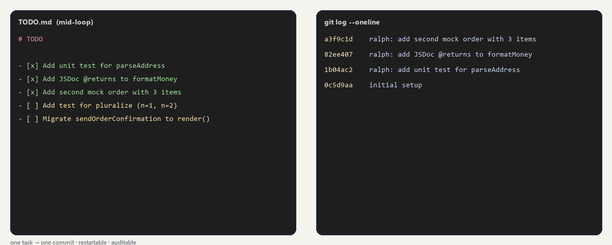
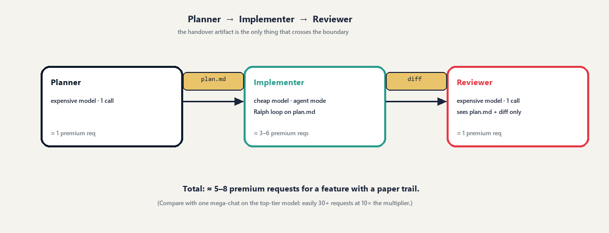

<!-- target: ~900 words (~300 each) -->

## Three workflow patterns that compound

The levers shrink the cost of a single turn. The patterns shrink the *number* of expensive turns, and each one fits a different shape of work:

| Pattern | Shape of work |
|---|---|
| Loop with state on disk | Many small, independent tasks |
| Checkpoint & reset | One long task |
| Plan → Build → Review | One feature, several roles |

---

### 1. Loop with state on disk (the Ralph loop)

Geoffrey Huntley named it after Ralph Wiggum: relentless, not clever. Write a `TODO.md` of small checkbox tasks, then have an agent do the first unchecked item, run the tests, tick the box, commit, and repeat.

The whole point is that **every iteration starts with a fresh, small context**. That's also where the first version of this demo went wrong. It ran the loop as one long prompt inside one chat ("repeat until `TODO.md` is done"), so item five carried the full transcript of items one to four. That isn't Ralph: it's a long chat with a to-do list.

Huntley's original is a shell loop, and that's what this repo now ships as `tools/ralph.sh`:

```bash
while grep -q '^- \[ \]' TODO.md; do
  claude -p "$(cat tools/ralph-prompt.md)" \
    --model sonnet --effort medium \
    --max-budget-usd 0.50 \
    --permission-mode acceptEdits \
    --allowedTools "Bash(mvn *) Bash(git add *) Bash(git commit *)"
done
```

Each `claude -p` is a new process with a new context. The only memory is on disk: `TODO.md` and the git log. That gives you:

- **Flat cost per item.** Item ten costs about what item one did.
- **A hard cap.** `--max-budget-usd` stops any single iteration that runs away.
- **Restartability.** Kill it halfway and run it again; it picks up at the first unchecked box.
- **An audit trail.** `git log --oneline` reads like a changelog, one commit per item.

One warning: `/loop` and session-scoped scheduled tasks look similar but are the opposite. They fire inside your current session and send its full context every time.

In Copilot, the cloud agent working one issue at a time gives you the same shape, and the shell loop works with any agent CLI that has a non-interactive mode.



---

### 2. Checkpoint & reset

Both tools now compact automatically when a session approaches the limit, so you don't need to hand-write summaries any more. What's left is deciding *when* to reset, because the options cost very different amounts:

| Action | What it costs | Use it when |
|---|---|---|
| `/clear` | Nothing | You're switching to an unrelated task. Run `/rename` first so you can `/resume` later. |
| `/rewind` | Little: it returns to a prefix that's already cached | The last few turns went down a wrong path |
| `/compact keep the failing test and the fix plan` | A request that reads the whole conversation: cheap while the cache is warm, expensive after a break | You're mid-task and want to keep going with less context |
| Auto-compaction | Same as `/compact`, but at a moment you didn't choose | You forgot the other three |

Two details make this work better in Claude Code:

- **Steer the summary.** Pass a focus to `/compact`, or add a `# Compact instructions` section to `CLAUDE.md` so every compaction keeps what matters to your project.
- **Know what survives.** The project-root `CLAUDE.md` or `AGENTS.md` is re-read from disk after compaction. Instructions you gave only in the chat are not, so anything you'll need again belongs in a file.

For a deliberate hand-off between sessions, ask for a short `NOTES.md` (goal, decisions, files touched, next step), run `/clear`, and continue with *"Read @NOTES.md and do the next step"*.

**Rule of thumb:** one task per session, and compact at a natural break rather than waiting for the automatic one mid-task.

---

### 3. Plan → Build → Review

This is the pattern that changes how a feature gets built. Three roles, three contexts, and one artifact that crosses the boundaries:



In Claude Code each role is a subagent in `.claude/agents/`, with its own model, effort and tool list:

| Subagent | Model · effort | Tools | Produces |
|---|---|---|---|
| `planner` | Opus · high | Read, Grep, Glob, Write | `plan.md`: goal, acceptance criteria, small tasks. No code. |
| `implementer` | Sonnet · medium | Read, Edit, Write, Bash | One commit per task, tests green after each |
| `reviewer` | Opus · high | Read, Grep, Glob, Bash | PASS/FAIL per criterion, then `VERDICT: APPROVE` or `REQUEST CHANGES` |

Why this saves tokens:

- **Each subagent starts with a fresh context.** It sees the brief and `plan.md`, not your conversation.
- **Only summaries come back.** The implementer's test logs and file reads stay in its own context.
- **Your main session keeps its model and its cache.** A subagent call appends to the parent conversation and leaves the cached prefix intact, so you get Opus planning without switching your session to Opus.

The discipline that makes it work: the artifact (`plan.md`, the diff, the review) is the only thing that crosses a boundary. Never paste chat history into the next role.

Copilot users can get the same shape with prompt files run in three fresh chats; this repo keeps those under `.github/prompts/`.

#### A warning about fan-out

Subagents are not free. Each one loads its own context (your instructions, its tools, the files it reads) and warms its own cache. Anthropic measured **agent teams at about 7× the tokens** of a standard session when teammates run in plan mode. Use several agents when the roles genuinely need different contexts, not because parallel feels faster.

---

### They compose

The planner writes `plan.md`. The implementer runs a Ralph loop over its tasks, one commit each. A long implementer session checkpoints instead of dragging its history along. The reviewer sees only the plan and the diff. Each piece is cheap on its own, and together they make an expensive model's judgement go a long way.
