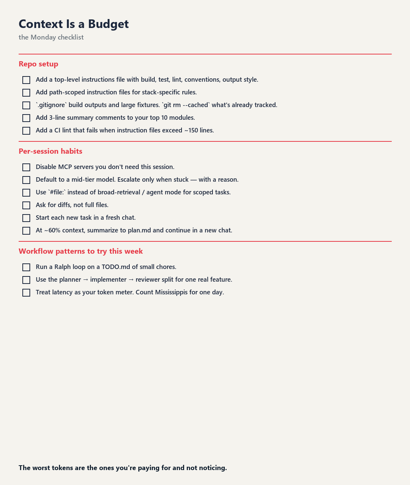

<!-- target: ~250 words -->

## The Monday checklist

Pin this to your team's wiki. Take what's useful, ignore the rest.

**Repo setup**
- [ ] One always-loaded instructions file (`AGENTS.md`, `CLAUDE.md` or `copilot-instructions.md`) under 200 lines: build, test, conventions, output style.
- [ ] If you have both `AGENTS.md` and `CLAUDE.md`, make `CLAUDE.md` import `@AGENTS.md`.
- [ ] Scoped rules for directory-specific conventions (`.claude/rules/` with `paths:`, or `*.instructions.md` with `applyTo:`), with globs as narrow as the rule.
- [ ] Workflow-specific instructions moved into skills or subagents.
- [ ] A hook that trims test and build output before the agent sees it.
- [ ] Dead code deleted; generated folders in `.gitignore` and in a `Read` deny rule.
- [ ] A CI lint for instruction size and over-broad globs.

**Per-session habits**
- [ ] Name the file and method in the prompt. Use plan mode for anything multi-file.
- [ ] Pick the model at the start of a session. Turn effort up or down mid-task; switch model only after `/clear`.
- [ ] Default to Sonnet at medium effort. Use Haiku for subagents that search and summarise.
- [ ] `/clear` between unrelated tasks. `/compact <focus>` at natural breaks, not mid-task.
- [ ] Ask for short answers. Let the instructions file make it the default.

**Measure**
- [ ] A status line showing context %, cache hit rate and cost.
- [ ] `/usage` once a day for a week. Act on anything with a share above 10%.
- [ ] `--max-budget-usd` on every headless run.

**Workflow patterns to try this week**
- [ ] Run `tools/ralph.sh` (or your own shell loop) over a `TODO.md` of small chores.
- [ ] Build one real feature with planner, implementer and reviewer subagents. Compare the cost with how you'd normally do it.

